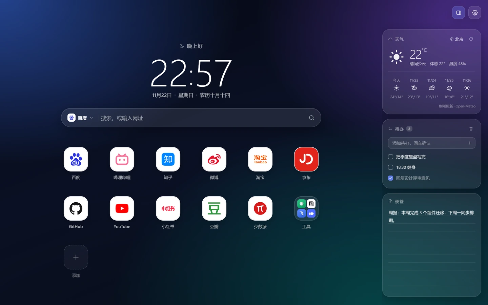
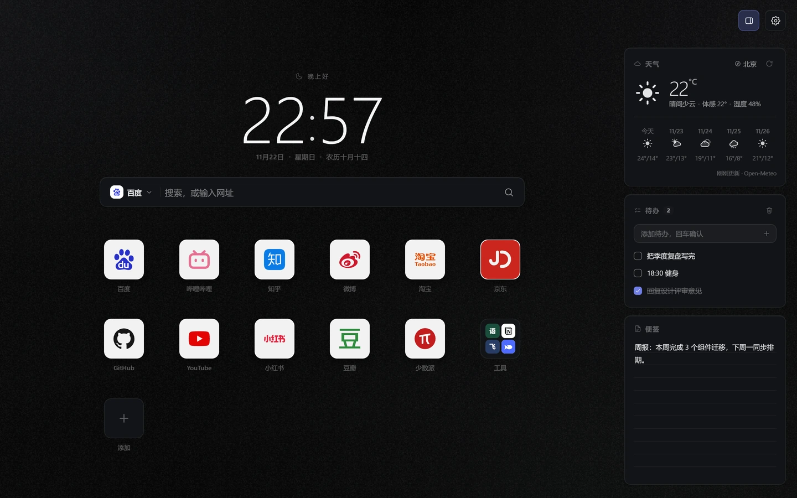
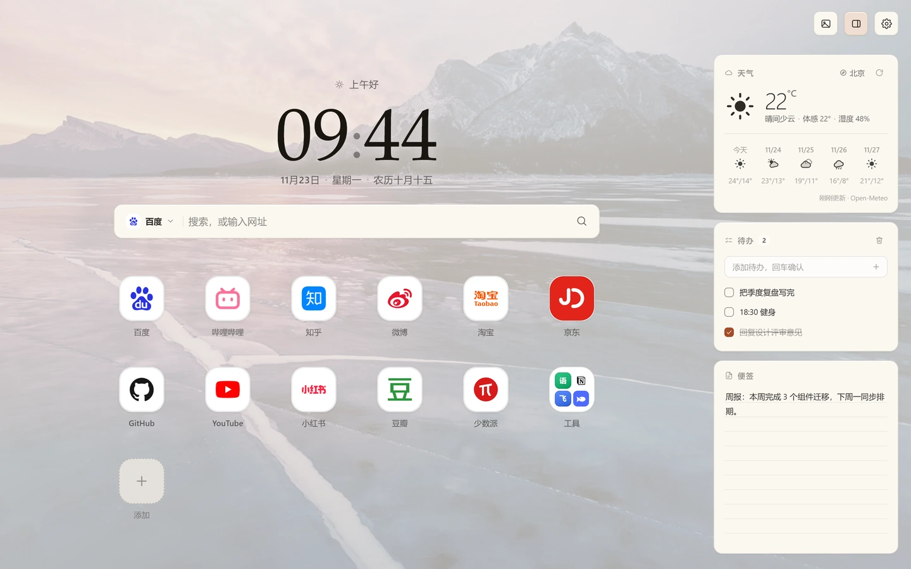
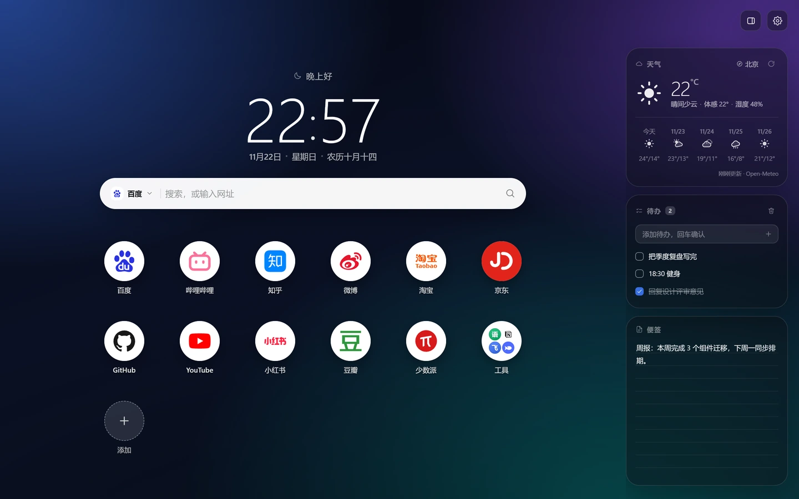
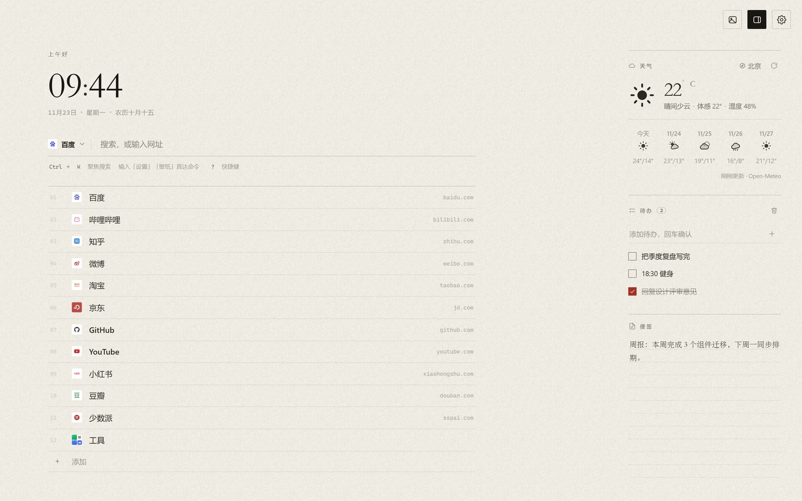
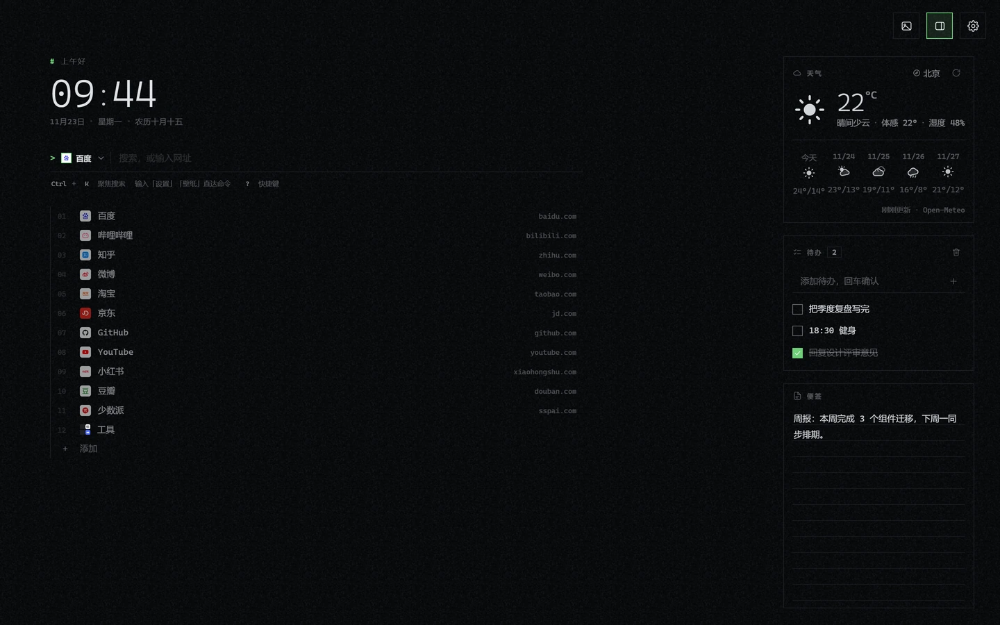
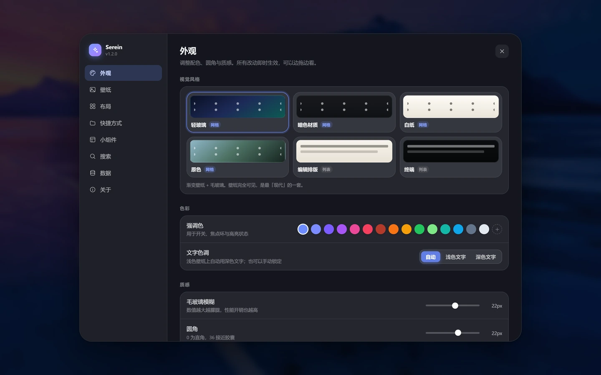
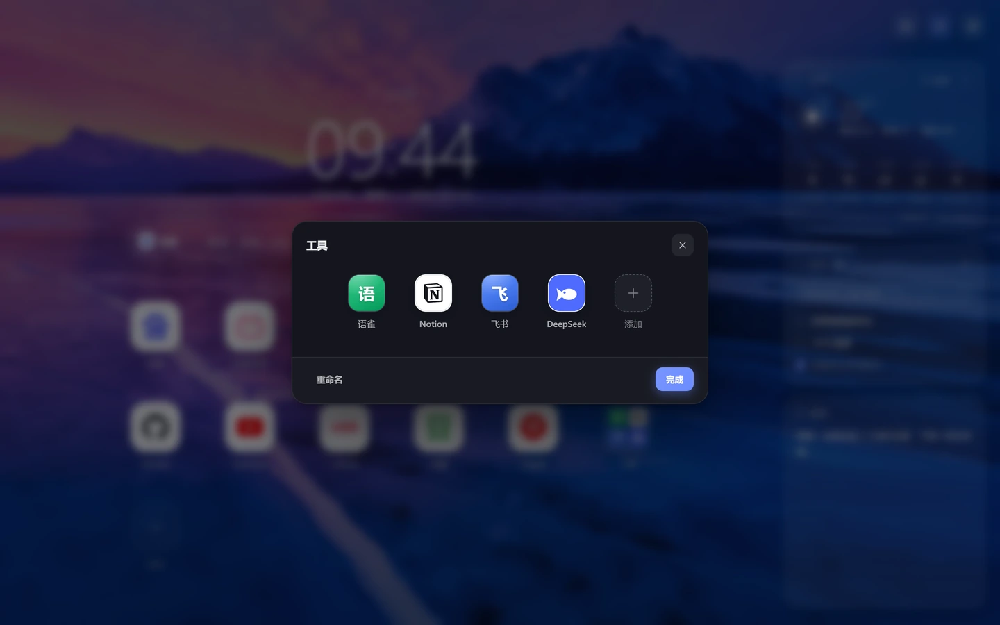
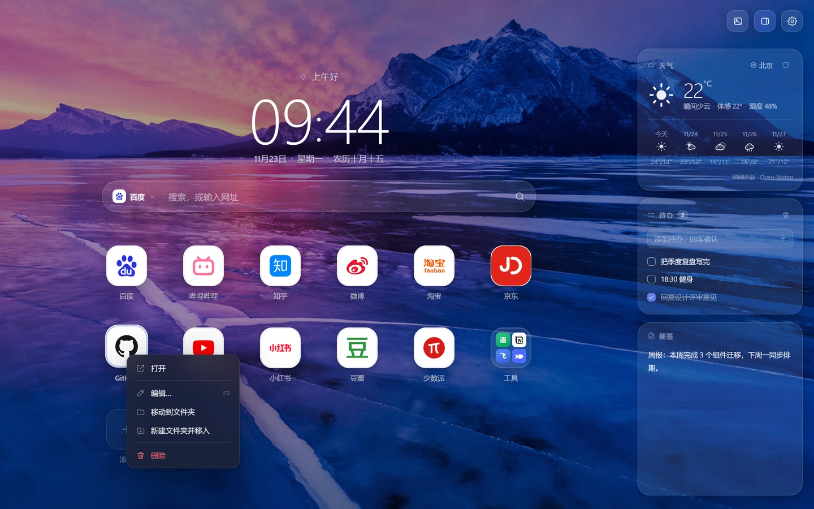

# Serein 新标签页

> 自有的 Infinity 新标签页（Pro）平替。**零依赖、零构建、纯静态 MV3 扩展** —— 选中 `src/` 目录「加载已解压」即可运行，不需要 Node、不需要 npm install。



---

## 一、它解决什么问题

选型时的取舍结论是：

- 美学向项目（Tabliss / Bonjourr / mue）没有「文件夹 + 图标网格」这套信息架构；
- 拨号盘类项目（YASD / TabMark / Lemon）有分组，但没有一体化仪表盘；
- 功能最接近的 nightTab 刻意零权限，因此**完全没有同步**，只有 JSON 导入导出；
- 商业产品（Infinity / iTab / WeTab）把图标点击做成了联盟 CPS，且把数据锁在账号里。

Serein 的做法是把上面几件事一次做对：

| | Infinity Pro | Serein |
|---|---|---|
| 图标点击 | 会被改写成联盟推广链接 | **永不改写**，就是你自己存的 URL |
| 数据归属 | 账号 + 云端，忘记密码等于丢数据 | 只在本机，随时导出 JSON |
| 同步 | 强制登录 | 不需要（导出/导入即可） |
| 权限 | 一堆常驻权限 | 常驻只有 `storage` / `unlimitedStorage` / `favicon` |
| 可改性 | 黑盒 | 源码可读，改一行 CSS 就换风格 |

---

## 二、预览

> 下面所有截图用的是同一张必应每日一图当壁纸（「冰下秘境」，加拿大亚伯拉罕湖，© Guang Cao/Getty Images），方便横向比较六套风格对同一张照片的处理差异。

**六套视觉风格** —— 每套都是完整的表层语言替换（色彩、表面材质、版面网格、图标呈现），不只是换一个颜色。

| 轻玻璃 · 网格 | 暗色材质 · 网格 |
|---|---|
|  |  |
| **白纸 · 网格** | **原色 · 网格** |
|  |  |
| **编辑排版 · 列表** | **终端 · 列表** |
|  |  |

| 设置面板（外观） | 文件夹 |
|---|---|
|  |  |



壁纸来源有渐变预设、必应每日一图、图片链接、本地上传和纯色；用必应时右上角会多出「换一张壁纸」，壁纸页还能回看最近 8 天的每日一图。

---

## 三、功能

**首屏**

- 大号时钟：24/12 小时制、可显示秒、可关
- 日期 + 星期 + **农历**（1900–2050，带内置自校验，不可信时自动隐藏而不是显示错日期）+ 节日（春节/元宵/端午/七夕/中秋/重阳/腊八/除夕 + 公历节日）
- 时段问候语，可填称呼（「晚上好，小明」）
- 搜索框：多引擎切换、网址直开、本地快捷方式匹配、**命令直达**（输入「设置」「壁纸」「布局」直接执行）、**最近搜索**（本机保存、可一键清除）、远程联想（Google / 必应 / 百度 / 360 / DuckDuckGo / 哔哩哔哩）、匹配词高亮与完整键盘导航

**快捷方式**

- 图标网格：列数 / 图标大小 / 间距全部可调，末行自动居中
- **列数双通道**：拖滑块找手感，旁边的步进器（`−` / 数字 / `+`）给精确值；改动即时生效并回显「内容宽约 xxx px」
- **内置矢量品牌图标**：80+ 主流站点（百度 / 哔哩哔哩 / 知乎 / 微博 / 淘宝 / 京东 / 小红书 / GitHub / YouTube / Notion / Figma / Google / Microsoft …）用官方色字形、48×48 本地 SVG，离线可用、任意尺寸清晰、首屏不闪字符
- **图标来源可切换**（设置 → 外观 → 图标）：品牌图标（默认）/ 网站图标（Chrome 本地缓存）；单个图标也能在编辑弹窗里指定「自动 / 网站图标 / 表情 / 文字 / 图片链接 / 本地上传」
- 未收录的站点按「内置图标 → 站点图标 → 品牌色字符徽标」逐级降级，永远不会出现空白方块
- **文件夹**：新建、重命名、解散；图标可拖入拖出；磁贴内 2×2 缩略预览
- **拖拽排序**：主面板任意排序，快捷方式与文件夹可任意交错
- 右键菜单：打开、编辑、移动到文件夹、新建文件夹并移入、删除
- **删除可撤销**：删除后 6 秒内点提示条上的「撤销」即可原样恢复（文件夹连同内容一起）
- **空白处右键**也能唤出菜单（添加快捷方式 / 新建文件夹 / 更换壁纸 / 调整布局 / 设置）
- 键盘：`←→↑↓` 移动焦点、`Enter` 打开、`F2` 编辑、`Delete` 删除
- 中键 / `Ctrl/⌘ + 点击` 后台打开，`Shift + 点击` 前台新标签页打开

**小组件（右侧栏，可左可隐藏）**

- 天气：当前温度 / 体感 / 湿度 / 5 日预报，城市可搜索切换（Open-Meteo，无 Key）
- 待办：勾选、删除、清除已完成
- 便签：自动保存，**卡片弹性撑满侧栏剩余高度**（右列不会留空档）
- 书签 / 常去网站：按需申请权限，不授权就不出现

**壁纸与外观**

- **六套视觉风格**（设置 → 外观）：轻玻璃 / 暗色材质 / 白纸 / 原色 / 编辑排版 / 终端。每套是完整的表层语言替换——色彩体系、表面材质、版面网格、图标呈现方式，而不只是换个颜色
- **顶栏只留操作**：左上角不放字标、也不放图标，打开就是干净的壁纸；右上角的「侧边栏开关 + 设置」始终贴窗口右缘，侧边栏展开时与侧栏卡片右缘对齐
- 壁纸来源：10 套离线 CSS 渐变 / 必应每日 / 图片链接 / 本地上传 / 纯色
- **必应历史画廊**：可回看最近 8 天的每日一图，点任意一张即刻固定下来
- 模糊、亮度、饱和度、暗角；**风格遮罩**按风格分别记忆（暗色材质与白纸默认 45%，轻玻璃与原色不压），可逐风格调低让壁纸透出更多
- **文字色调自动判定**：从壁纸亮度采样，浅色壁纸上自动切成深色文字
- 强调色、圆角、毛玻璃强度、界面缩放、动效开关
- **性能模式**：一键关掉毛玻璃与壁纸漂移动画（显卡驱动异常时的唯一解）
- **设置是独立场景**：打开设置时页面本体后退成背景（壁纸保留），遮罩不跟随风格配色，快捷方式与小组件不会再和面板糊在一起
- **按需加载**：设置面板与各类弹窗合计约 85 KB，首次打开时才拉取，新标签页首屏只解析必要模块

**数据**

- 导出 / 导入 JSON 备份
- 存储用量面板
- 恢复默认
- 从浏览器书签批量导入

---

## 四、安装

### Chrome / Edge

1. 打开 `chrome://extensions`（Edge 是 `edge://extensions`）
2. 打开右上角「开发者模式」
3. 点「加载已解压的扩展程序」
4. **选择本仓库的 `src` 目录**
5. 新建标签页

工具栏图标（点击可重新打开新标签页）使用 `assets/img/icon-*.png`，已随仓库提供，不需要任何生成步骤。

### 首次使用

第一次打开会自动生成 11 个常用站点 + 1 个「工具」文件夹，直接可用。
按 `F2` 或右键任意图标就能改成你自己的。

### 上架到扩展商店

打包：`powershell -ExecutionPolicy Bypass -File scripts/package.ps1` → `dist/serein-newtab-v<版本>.zip`。

- 两个商店的注册、上传、隐私表单与审核注意事项：[docs/publishing.md](docs/publishing.md)
- 商品页文案、权限理由、单一用途声明：[docs/store-listing.md](docs/store-listing.md)
- 商店素材（1280×800 截图、440×280 / 1400×560 宣传图、300×300 logo）：[docs/store/](docs/store)

---

## 五、快捷键

| 快捷键 | 作用 |
|---|---|
| `Ctrl/⌘ + K` | 聚焦搜索框 |
| `/` | 聚焦搜索框（非输入状态） |
| `?` | 打开「关于」查看快捷键与权限 |
| `Ctrl/⌘ + ,` | 打开设置 |
| `Esc` | 关闭浮层；在搜索框里先收起联想，再按一次清空输入 |
| `↑ ↓` | 在搜索结果间移动 |
| `Tab` | 收起联想并离开搜索框 |
| `← → ↑ ↓` | 在图标间移动焦点 |
| `Enter` | 打开选中图标 |
| `F2` | 编辑选中图标 |
| `Delete` | 删除选中图标 |

---

## 六、数据与隐私

**存储位置**

| 内容 | 位置 |
|---|---|
| 配置、快捷方式、待办、便签 | `localStorage`（键 `serein.state.v1`），同步读取，首屏 0ms 出骨架 |
| 上传的壁纸、上传的图标 | IndexedDB（`serein-assets`） |
| 兜底镜像 | `chrome.storage.local`，最多 5 分钟写一次，关窗前强制写 |

**清理浏览数据后会自动恢复**：如果某次打开时发现 `localStorage` 是空的、而镜像里有数据（说明缓存被清理了），会把配置从镜像搬回来、写回 `localStorage` 并提示一次。首次安装时两边都为空，不会误触发。

**不会发生的事**

- 没有账号，没有服务器，没有云端同步
- 不会上传任何浏览数据
- 不会把你的图标 URL 改写成推广链接
- 不会修改浏览器默认搜索引擎

**会发出的网络请求**

| 域名 | 用途 |
|---|---|
| `cn.bing.com` | 必应每日壁纸（仅当你选择了必应壁纸） |
| `api.bing.com` | 必应搜索联想 |
| `suggestion.baidu.com` | 百度搜索联想 |
| `sug.so.360.cn` | 360 搜索联想 |
| `suggestqueries.google.com` | Google 搜索联想 |
| `duckduckgo.com` | DuckDuckGo 搜索联想 |
| `s.search.bilibili.com` | 哔哩哔哩搜索联想 |
| `api.open-meteo.com` | 天气 |
| `geocoding-api.open-meteo.com` | 城市搜索 |

搜索联想可以在设置里关掉；关闭后不会请求任何联想接口。最近搜索只写在 `localStorage` 里，可以随时在设置中关闭记录或清除。城市搜索只在你打开城市选择器并输入关键词时请求。所有域名在 `manifest.json` 的 `host_permissions` 里显式列出，没有 `<all_urls>`。

需要对外引用（例如提交到扩展商店）时，用 [PRIVACY.md](PRIVACY.md)：内容与本段一致，含中英双语。

---

## 七、目录结构

```
src/
├── manifest.json               MV3 清单（权限、覆盖页、图标）
├── newtab.html                 新标签页骨架（静态首屏，无白屏）
├── assets/
│   ├── css/
│   │   ├── tokens.css          设计令牌 + 明暗双色调 + 性能/动效开关
│   │   ├── app.css             背景、时钟、搜索、网格、磁贴、卡片、顶栏
│   │   ├── styles.css          六套视觉风格的表层覆写
│   │   └── overlays.css        设置面板、弹窗、右键菜单、Toast
│   ├── img/                    icon-16/32/48/128.png + 纸张噪点 noise.png
│   ├── brand/                  内置站点图标（80 个 48×48 SVG）+ NOTICE.md
│   └── js/
│       ├── main.js             启动入口、顶栏、Toast
│       ├── prepaint.js         首帧前置：加载样式表前先落 data-style / data-tone
│       ├── util.js             DOM 助手、事件总线、URL/颜色工具、内联图标
│       ├── storage.js          localStorage / IndexedDB / chrome.storage 三通道
│       ├── defaults.js         默认配置、渐变预设、搜索引擎、种子数据、迁移
│       ├── store.js            单一状态树 + 订阅（替代 Pinia）
│       ├── theme.js            配置 -> CSS 变量
│       ├── wallpaper.js        壁纸解析、滤镜、文字色调采样
│       ├── lunar.js            农历（含春节日期反向校验）
│       ├── icons.js            图标解析：自定义 -> 内置品牌图标 -> _favicon -> 品牌色徽标
│       ├── brands.js           host -> 内置图标 slug 的索引（含子域回退）
│       ├── clock.js            时钟、日期、农历、问候
│       ├── search.js           搜索框、多引擎、最近搜索、联想、键盘导航
│       ├── menu.js             右键菜单（单例）
│       ├── modals.js           弹窗基座、快捷方式编辑器、确认/输入框
│       ├── tiles.js            图标网格、文件夹、拖拽、右键菜单
│       ├── weather.js          Open-Meteo 天气与城市搜索
│       ├── widgets.js          天气 / 待办 / 便签 / 书签
│       ├── settings.js         设置面板（8 个分区）
│       ├── data.js             导入 / 导出 / 重置 / 用量
│       └── background.js       Service Worker（工具栏图标点击）

docs/
├── screenshots/                README 用的预览图
├── store/                      商店素材：截图、宣传图、logo
├── publishing.md               上架流程（Chrome Web Store / Edge Add-ons）
└── store-listing.md            商店文案与权限理由

scripts/package.ps1             打包上传用的 zip（产物在 dist/，不入库）
PRIVACY.md                      隐私政策（商店要求填写的链接）
```

---

## 八、二次开发

没有构建步骤。改完文件后在扩展管理页点「重新加载」即可。

| 想改什么 | 改哪里 |
|---|---|
| 配色 / 圆角 / 字号阶梯 | `assets/css/tokens.css` 的 CSS 变量 |
| **视觉风格** | `assets/css/styles.css`（每套风格一个 `html[data-style="…"]` 区块）+ `assets/js/defaults.js` 的 `STYLES` |
| 顶栏与侧栏对齐 | `app.css` 的 `.topbar` / `html[data-sidebar…]` |
| 新增渐变壁纸 | `assets/js/defaults.js` → `GRADIENTS` |
| 新增搜索引擎 | `assets/js/defaults.js` → `ENGINES` |
| 新增站点品牌色 | `assets/js/icons.js` → `BRAND` |
| **新增内置站点图标** | 放一个 `assets/brand/<slug>.svg`，再到 `assets/js/brands.js` 里登记 host（许可与来源见 `assets/brand/NOTICE.md`） |
| 新增 UI 图标 | `assets/js/util.js` → `PATHS` |
| 默认种子快捷方式 | `assets/js/defaults.js` → `SEED_SHORTCUTS` |

设置项改动会即时写入 `localStorage`（180ms 防抖），无需手动保存。

### 六套视觉风格的取舍

| 风格 | 形态 | 主张 | 壁纸 | 图标呈现 |
|---|---|---|---|---|
| 轻玻璃 | **网格** | 现代、放松，壁纸是主角 | 完全可见 | 彩色方块网格 |
| 暗色材质 | **网格** | 像一块加工过的金属：固态表面 + 上打光 | 压暗 45% 并去饱和 | 暗底彩色方块网格 |
| 白纸 | **网格** | 暗色材质的纸面版：暖白纸、发丝线、衬线数字 | 压到 45% 暖白遮罩（壁纸页可调）并褪色到 45%，保留约一半壁纸 | 白色纸块 + 极浅投影 |
| 原色 | **网格** | 壁纸原样呈现，图标还原品牌色 | 完全可见，不做任何处理 | 圆形品牌图标直接浮在壁纸上 |
| 编辑排版 | 列表 | 用字号和网格说话，不用颜色和模糊 | 不使用（纸色底 + 噪点） | 编号文字目录 |
| 终端 | 列表 | 它是工具，不是仪表盘 | 不使用（近黑底） | 编号文字目录，图标缩到 16px |

**快捷方式是网格还是列表，由视觉风格决定**：轻玻璃 / 暗色材质 / 白纸 / 原色 用图标网格，编辑排版 / 终端 用文字目录。
两个入口都能切：

- 设置 → 外观 → 视觉风格（每张卡片上标了「网格 / 列表」，缩略图也会画出对应形态）
- 设置 → 布局 → 排列 → 快捷方式形态 → 「换成图标网格 / 换成文字列表」

「每行列数」「图标大小」「列间距」「行间距」只对图标网格生效，列表形态下不参与排版。
列数可在 3–14 之间调：滑块用来找手感，步进器用来给精确值，两者双向同步，行内提示会实时算出「内容宽约 xxx px」。
列间距与行间距是两个独立滑块（各 4–64px）：列间距同时决定网格与搜索框的内容宽度，行间距只管纵向留白；旧配置里只有单一间距的，会按「列距 × 0.9」自动换算出行距。

切换风格会自动带上该风格的推荐强调色，之后仍可单独改。

### 性能上的取舍

新标签页每次开都要在 100ms 内出画面，所以能省的合成与重排都省了：

- **磁贴不再各自开 `backdrop-filter`**：一屏十几层实时模糊是最大的合成开销，而 9% 白的底色本来就看不出模糊
- **首帧前置脚本**（`assets/js/prepaint.js`）在样式表之前同步落好 `data-style / data-tone`，切到白纸或终端时不会先闪一帧默认深色
- **网格一次性用 `DocumentFragment` 插入**，磁贴加 `contain: layout style`，拖动排序不牵动整页重排
- **顶栏按签名重建**：只在「壁纸类型 / 侧边栏位置」变化时重绘，拖设置里的滑块不再反复创建 DOM
- **固定明暗的风格跳过壁纸采样**：少一次离屏 canvas 解码，首屏没有色调跳变
- **时钟只在文本真的变化时写 DOM**，后台标签页直接跳过；日期与农历一天只算一次
- **省电模式**额外关闭壁纸漂移动画（`html[data-perf='1'] .bg-media.is-slow`）

---

## 九、已知限制

1. **没有跨设备同步** —— 这是刻意的。配置和快捷方式用导出/导入 JSON 迁移；上传的壁纸/图标文件保存在本机 IndexedDB，**不包含在 JSON 里**，换设备后需要重新上传（未上传时会自动退回渐变/字符图标，不会破图）。
2. **图标抓取依赖 `_favicon`** —— 这是 Chrome 内置的本地 favicon 服务。个别站点没有 favicon 时会退回到品牌色字符徽标（不是破图，是设计过的兜底）。
3. **必应壁纸版权** —— 来自必应公开接口，其 JSON 自带「此图片不能下载用作壁纸」声明，仅供个人桌面欣赏。要商用请换成自有素材。
4. **Open-Meteo 免费层禁商用** —— 商用需替换为 QWeather 等服务。
5. **无痕窗口无法覆盖新标签页** —— Chrome 平台限制，任何扩展都做不到。
6. **设置里的搜索只影响本页跳转** —— 绝不修改浏览器默认搜索引擎（那会触发应用商店额外审核）。
7. **依赖 `color-mix()`** —— 需要 Chrome/Edge 116 及以上（`manifest.json` 已声明 `minimum_chrome_version`）。
8. **刷新/异常退出可能留下旧图标文件** —— 删除/替换上传图标后会等 6 秒撤销窗口结束再回收；如果在这 6 秒内刷新、崩溃或强杀浏览器，IndexedDB 里可能留下未被引用的旧文件（点「恢复默认设置」会在清空配置时一并清理）。

---

## 十、许可

本项目为净室实现，未包含任何 GPL / AGPL 项目的代码。
天气数据由 [Open-Meteo](https://open-meteo.com/) 提供；每日壁纸来自必应公开接口，版权归原作者。
